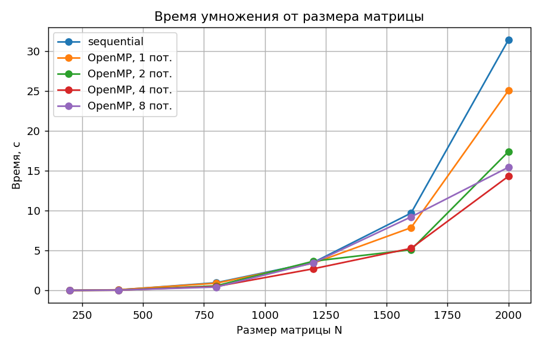
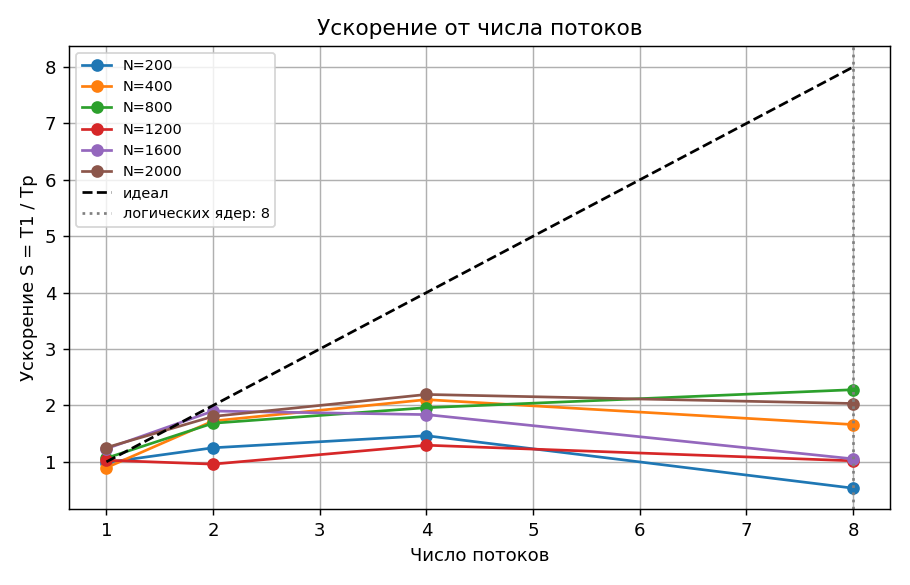
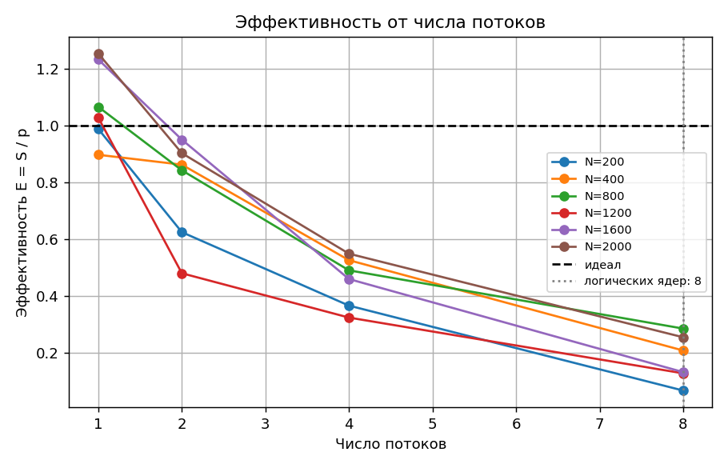
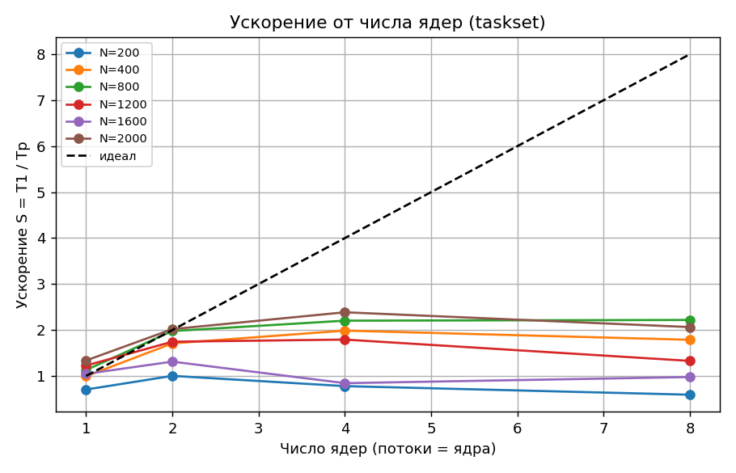

# Лабораторная работа №2

## Параллельное умножение квадратных матриц на OpenMP

**Курс:** Параллельное программирование, 2026 **Дедлайн:** 15.10.2026

**Студент:** Храмов Кирилл  **Группа:** 6212-100503D

---

## Задание

Модифицировать программу из л/р №1 для параллельной работы по технологии OpenMP.

- Провести серию экспериментов с разным количеством потоков (1, 2, 4, 8 и т.д.).
- Использовать разные размеры матриц (примерно 200, 400, 800, 1200, 1600, 2000).
- Использовать разное количество вычислительных ядер при наличии технической возможности, иначе фиксированное существующее количество ядер.

## Среда выполнения

- **Устройство:** 12th Gen Intel(R) Core(TM) i3-1215U (8 логических ядер)
- **ОС:** Linux-6.18.40.1-microsoft-standard-WSL2-x86_64-with-glibc2.43 (WSL)
- **Компилятор:** c++ (Ubuntu 15.2.0-16ubuntu1) 15.2.0, C++17, OpenMP
- **Сборка:** CMake + Make (Release, `-O3`)
- **Верификация/анализ:** Python 3, NumPy, Matplotlib

## Реализация

В `src/main.cpp` к стратегиям `sequential` и `parallel_threads` добавлена **parallel_openmp**:

```cpp
omp_set_dynamic(0);
omp_set_num_threads(T);
#pragma omp parallel for schedule(static)
for (int i = 0; i < N; ++i)
    for (int j = 0; j < N; ++j) { /* sum по k */ }
```

Внешний цикл по строкам результирующей матрицы делится между `T` потоками статически (равными блоками строк). Каждый поток
пишет только в свои строки `C`, поэтому синхронизация не нужна. `omp_set_dynamic(0)` отключает автоподбор, чтобы число потоков
было ровно `T`. Время замеряется `std::chrono::high_resolution_clock` строго вокруг вычисления, без чтения и записи файлов.

Ускорение S = `T_sequential / T_p`, эффективность E = `S / p`, где `T_sequential` - последовательная версия на том же
размере в той же серии запусков.

### Сборка и запуск

```bash
mkdir build && cd build
cmake ..
make
cd ..

python3 tools/generate.py 500 data/input_500.txt     # генерация входных данных
./build/matmul data/input_500.txt 4 omp              # OpenMP, 4 потока
python3 tools/verify.py data/input_500.txt data/output_500_parallel_openmp_t4.txt

./tools/run_experiments_lab2.sh                      # вся серия экспериментов, графики, этот отчёт
```

## Эксперименты

- Размеры N: 200, 400, 800, 1200, 1600, 2000
- Потоки OpenMP на всех ядрах машины: 1, 2, 4, 8
- Число ядер (потоки = ядра, процесс привязан через `taskset`): 1, 2, 4, 8
- Запусков на конфигурацию: 3; в таблицах среднее, минимум и стандартное отклонение σ.

## Результаты

Исходные данные для графиков (то же в `data/results_lab2.csv`, по запускам).

### Серия по числу потоков

| N | Режим | Потоки | Ядра | Запусков | t средн., с | t мин., с | σ, с | Ускорение S | Эффективность E | GFLOPS | Верификация | Макс. отн. погрешность |
|---|---|---|---|---|---|---|---|---|---|---|---|---|
| 200 | sequential | 0 | все | 3 | 0.0064 | 0.0060 | 0.0003 | 1.00 | - | 2.516 | OK | 1.1e-06 |
| 200 | OpenMP | 1 | все | 3 | 0.0064 | 0.0058 | 0.0007 | 0.99 | 0.99 | 2.486 | OK | 1.1e-06 |
| 200 | OpenMP | 2 | все | 3 | 0.0051 | 0.0038 | 0.0009 | 1.25 | 0.62 | 3.143 | OK | 1.1e-06 |
| 200 | OpenMP | 4 | все | 3 | 0.0043 | 0.0041 | 0.0002 | 1.46 | 0.37 | 3.681 | OK | 1.1e-06 |
| 200 | OpenMP | 8 | все | 3 | 0.0119 | 0.0093 | 0.0035 | 0.53 | 0.07 | 1.340 | OK | 1.1e-06 |
| 400 | sequential | 0 | все | 3 | 0.0748 | 0.0715 | 0.0044 | 1.00 | - | 1.710 | OK | 6.0e-07 |
| 400 | OpenMP | 1 | все | 3 | 0.0834 | 0.0778 | 0.0043 | 0.90 | 0.90 | 1.534 | OK | 6.0e-07 |
| 400 | OpenMP | 2 | все | 3 | 0.0434 | 0.0389 | 0.0032 | 1.72 | 0.86 | 2.949 | OK | 6.0e-07 |
| 400 | OpenMP | 4 | все | 3 | 0.0356 | 0.0317 | 0.0033 | 2.10 | 0.53 | 3.597 | OK | 6.0e-07 |
| 400 | OpenMP | 8 | все | 3 | 0.0451 | 0.0406 | 0.0052 | 1.66 | 0.21 | 2.840 | OK | 6.0e-07 |
| 800 | sequential | 0 | все | 3 | 0.9673 | 0.9251 | 0.0425 | 1.00 | - | 1.059 | OK | 2.8e-07 |
| 800 | OpenMP | 1 | все | 3 | 0.9076 | 0.8379 | 0.0703 | 1.07 | 1.07 | 1.128 | OK | 2.8e-07 |
| 800 | OpenMP | 2 | все | 3 | 0.5742 | 0.4914 | 0.1026 | 1.68 | 0.84 | 1.783 | OK | 2.8e-07 |
| 800 | OpenMP | 4 | все | 3 | 0.4936 | 0.4064 | 0.0745 | 1.96 | 0.49 | 2.075 | OK | 2.8e-07 |
| 800 | OpenMP | 8 | все | 3 | 0.4245 | 0.4206 | 0.0040 | 2.28 | 0.28 | 2.412 | OK | 2.8e-07 |
| 1200 | sequential | 0 | все | 3 | 3.5250 | 3.3978 | 0.1541 | 1.00 | - | 0.980 | OK | 1.8e-07 |
| 1200 | OpenMP | 1 | все | 3 | 3.4301 | 3.3858 | 0.0425 | 1.03 | 1.03 | 1.008 | OK | 1.8e-07 |
| 1200 | OpenMP | 2 | все | 3 | 3.6743 | 2.4651 | 0.9984 | 0.96 | 0.48 | 0.941 | OK | 1.8e-07 |
| 1200 | OpenMP | 4 | все | 3 | 2.7234 | 2.1950 | 0.7373 | 1.29 | 0.32 | 1.269 | OK | 1.8e-07 |
| 1200 | OpenMP | 8 | все | 3 | 3.4640 | 2.7114 | 0.8684 | 1.02 | 0.13 | 0.998 | OK | 1.8e-07 |
| 1600 | sequential | 0 | все | 3 | 9.7000 | 8.7419 | 0.7536 | 1.00 | - | 0.845 | OK | 1.4e-07 |
| 1600 | OpenMP | 1 | все | 3 | 7.8697 | 7.4963 | 0.3944 | 1.23 | 1.23 | 1.041 | OK | 1.4e-07 |
| 1600 | OpenMP | 2 | все | 3 | 5.1037 | 4.6797 | 0.3495 | 1.90 | 0.95 | 1.605 | OK | 1.4e-07 |
| 1600 | OpenMP | 4 | все | 3 | 5.2801 | 4.1158 | 1.4677 | 1.84 | 0.46 | 1.551 | OK | 1.4e-07 |
| 1600 | OpenMP | 8 | все | 3 | 9.2202 | 8.3981 | 1.0632 | 1.05 | 0.13 | 0.888 | OK | 1.4e-07 |
| 2000 | sequential | 0 | все | 3 | 31.4374 | 28.3235 | 2.6272 | 1.00 | - | 0.509 | OK | 1.1e-07 |
| 2000 | OpenMP | 1 | все | 3 | 25.0833 | 22.4225 | 2.0293 | 1.25 | 1.25 | 0.638 | OK | 1.1e-07 |
| 2000 | OpenMP | 2 | все | 3 | 17.4148 | 16.8873 | 0.7398 | 1.81 | 0.90 | 0.919 | OK | 1.1e-07 |
| 2000 | OpenMP | 4 | все | 3 | 14.3272 | 12.9868 | 1.3629 | 2.19 | 0.55 | 1.117 | OK | 1.1e-07 |
| 2000 | OpenMP | 8 | все | 3 | 15.4566 | 14.6691 | 0.7019 | 2.03 | 0.25 | 1.035 | OK | 1.1e-07 |

### Серия по числу ядер (taskset)

| N | Режим | Потоки | Ядра | Запусков | t средн., с | t мин., с | σ, с | Ускорение S | Эффективность E | GFLOPS | Верификация | Макс. отн. погрешность |
|---|---|---|---|---|---|---|---|---|---|---|---|---|
| 200 | OpenMP | 1 | 1 | 3 | 0.0090 | 0.0073 | 0.0013 | 0.70 | 0.70 | 1.772 | NA | 0.0e+00 |
| 200 | OpenMP | 2 | 2 | 3 | 0.0063 | 0.0052 | 0.0013 | 1.00 | 0.50 | 2.521 | NA | 0.0e+00 |
| 200 | OpenMP | 4 | 4 | 3 | 0.0082 | 0.0044 | 0.0053 | 0.78 | 0.19 | 1.960 | NA | 0.0e+00 |
| 200 | OpenMP | 8 | 8 | 3 | 0.0107 | 0.0029 | 0.0072 | 0.59 | 0.07 | 1.490 | NA | 0.0e+00 |
| 400 | OpenMP | 1 | 1 | 3 | 0.0754 | 0.0699 | 0.0063 | 0.99 | 0.99 | 1.698 | NA | 0.0e+00 |
| 400 | OpenMP | 2 | 2 | 3 | 0.0438 | 0.0362 | 0.0085 | 1.71 | 0.85 | 2.922 | NA | 0.0e+00 |
| 400 | OpenMP | 4 | 4 | 3 | 0.0377 | 0.0371 | 0.0006 | 1.99 | 0.50 | 3.398 | NA | 0.0e+00 |
| 400 | OpenMP | 8 | 8 | 3 | 0.0419 | 0.0395 | 0.0022 | 1.79 | 0.22 | 3.056 | NA | 0.0e+00 |
| 800 | OpenMP | 1 | 1 | 3 | 0.8571 | 0.8210 | 0.0476 | 1.13 | 1.13 | 1.195 | NA | 0.0e+00 |
| 800 | OpenMP | 2 | 2 | 3 | 0.4892 | 0.4588 | 0.0251 | 1.98 | 0.99 | 2.093 | NA | 0.0e+00 |
| 800 | OpenMP | 4 | 4 | 3 | 0.4391 | 0.4164 | 0.0180 | 2.20 | 0.55 | 2.332 | NA | 0.0e+00 |
| 800 | OpenMP | 8 | 8 | 3 | 0.4361 | 0.4216 | 0.0127 | 2.22 | 0.28 | 2.348 | NA | 0.0e+00 |
| 1200 | OpenMP | 1 | 1 | 3 | 2.8730 | 2.7088 | 0.1162 | 1.23 | 1.23 | 1.203 | NA | 0.0e+00 |
| 1200 | OpenMP | 2 | 2 | 3 | 2.0200 | 1.8312 | 0.1515 | 1.75 | 0.87 | 1.711 | NA | 0.0e+00 |
| 1200 | OpenMP | 4 | 4 | 3 | 1.9674 | 1.8227 | 0.1126 | 1.79 | 0.45 | 1.757 | NA | 0.0e+00 |
| 1200 | OpenMP | 8 | 8 | 3 | 2.6555 | 2.5798 | 0.0728 | 1.33 | 0.17 | 1.301 | NA | 0.0e+00 |
| 1600 | OpenMP | 1 | 1 | 3 | 9.2747 | 8.9916 | 0.2510 | 1.05 | 1.05 | 0.883 | NA | 0.0e+00 |
| 1600 | OpenMP | 2 | 2 | 3 | 7.3950 | 6.7787 | 0.6019 | 1.31 | 0.66 | 1.108 | NA | 0.0e+00 |
| 1600 | OpenMP | 4 | 4 | 3 | 11.5043 | 8.9105 | 2.0839 | 0.84 | 0.21 | 0.712 | NA | 0.0e+00 |
| 1600 | OpenMP | 8 | 8 | 3 | 9.9307 | 9.4871 | 0.6264 | 0.98 | 0.12 | 0.825 | NA | 0.0e+00 |
| 2000 | OpenMP | 1 | 1 | 3 | 23.5240 | 23.3114 | 0.1729 | 1.34 | 1.34 | 0.680 | NA | 0.0e+00 |
| 2000 | OpenMP | 2 | 2 | 3 | 15.5722 | 14.4666 | 0.8103 | 2.02 | 1.01 | 1.027 | NA | 0.0e+00 |
| 2000 | OpenMP | 4 | 4 | 3 | 13.1784 | 12.7200 | 0.5270 | 2.39 | 0.60 | 1.214 | NA | 0.0e+00 |
| 2000 | OpenMP | 8 | 8 | 3 | 15.2371 | 14.6411 | 0.7042 | 2.06 | 0.26 | 1.050 | NA | 0.0e+00 |









## Верификация

Результат первого запуска каждой конфигурации серии «по потокам» (и sequential) сравнивался с `A @ B` из NumPy.
Допуск - `1e-5` относительно `|A|@|B|` (программа выводит числа с 6 значащими цифрами, порядок суммирования различается).
В серии «по ядрам» используется тот же код, что и в серии «по потокам», поэтому там верификация не повторялась (`NA`).

## Выводы

1. **Корректность.** Результаты OpenMP-версии совпали с эталоном NumPy (`A @ B`) для всех проверенных конфигураций, максимальная относительная погрешность 1.1e-06.
2. **Ускорение.** Максимальное ускорение S = 2.28 получено при N=800 и 8 потоках (эффективность E = 28%). Для самой большой матрицы (N=2000) при 8 потоках S = 2.03, E = 25%.
3. **Закон Амдала.** По S(N=2000, p=8) эффективная доля неускоряемой части оценивается примерно в 41.9%: это накладные расходы на создание потоков, неравномерность нагрузки и ограничения памяти (матрица B обходится по столбцам, потоки конкурируют за кэш и шину).
4. **Влияние размера.** Для малой матрицы (N=200) ускорение при 8 потоках 0.53, для большой (N=2000) - 2.03: чем больше N, тем меньше доля накладных расходов в общем времени.
5. **Ядра машины.** Максимум потоков (8) не превышает число логических ядер (8). Если процессор использует Hyper-Threading, рост ускорения после числа физических ядер заметно слабее, чем до него.
6. **Число ядер.** При ограничении процесса 8 ядрами (taskset) для N=2000 S = 2.06; без ограничения при том же числе потоков S = 2.03. Ускорение определяется числом реально доступных ядер, а не только числом потоков.
