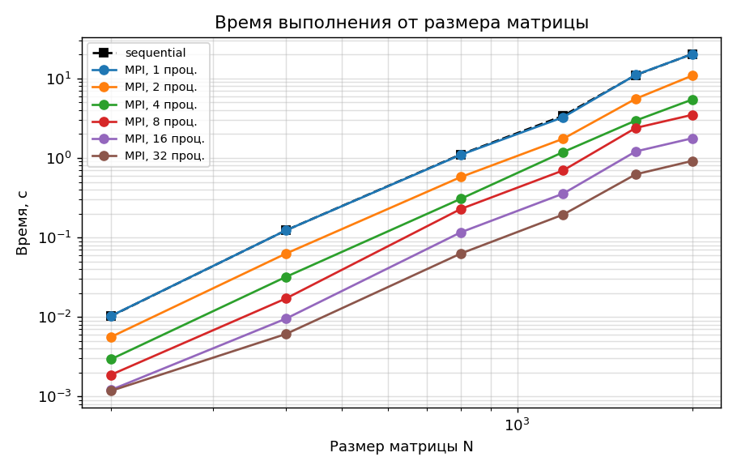
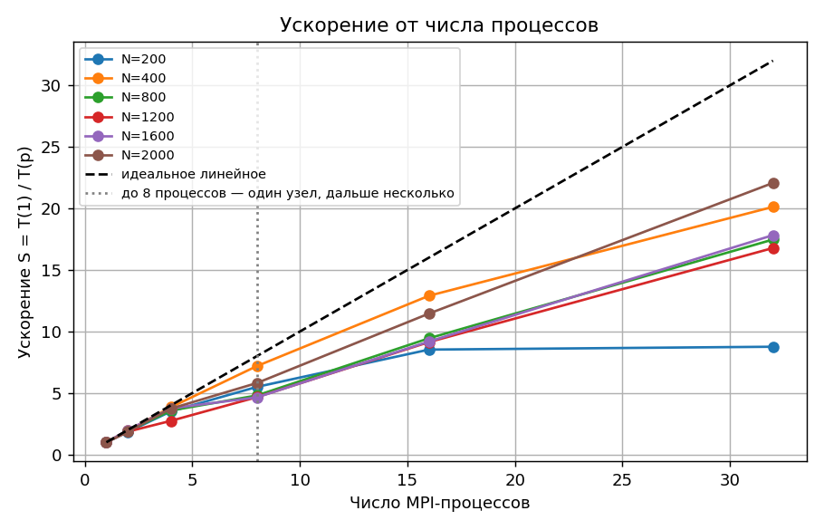
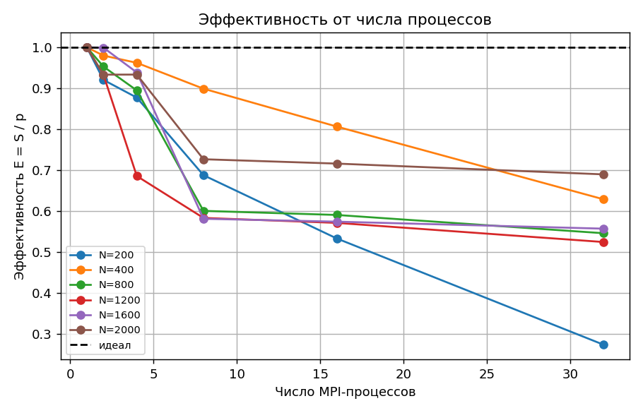
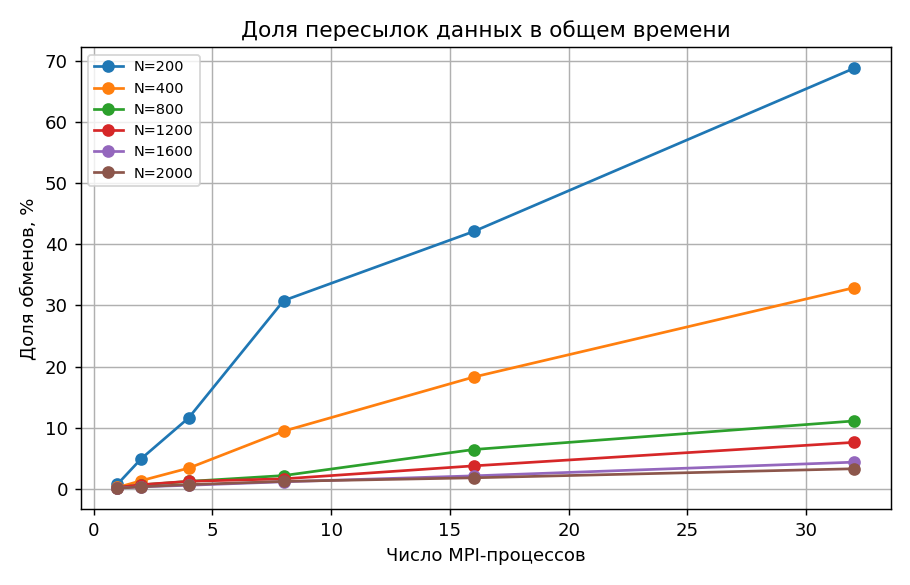

# Лабораторная работа №3

## Параллельное умножение квадратных матриц на MPI

**Курс:** Параллельное программирование, 2026 **Дедлайн:** 10.11.2026

**Студент:** Храмов Кирилл  **Группа:** 6212-100503D

---

## Задание

Модифицировать программу из л/р №1 для параллельной работы по технологии MPI.

- Провести серию экспериментов с разными размерами матриц (200, 400, 800, 1200, 1600, 2000).
- Провести серию экспериментов с разным количеством вычислительных ядер (1, 2, 4, 8, 16, 32 процессов).
- Запустить параллельную версию на суперкомпьютере «Сергей Королёв».

## Среда выполнения

- **Платформа:** суперкомпьютер «Сергей Королёв» (Самарский университет)
- **Планировщик:** SLURM, job 344851; узлы задачи: n239 n242 n246 n249
- **Процессор узла:** Intel(R) Xeon(R) CPU X5670 @ 2.93GHz (12 ядер в узле; в задаче занималось по 8 процессов на узел)
- **ОС:** CentOS Linux release 7.9.2009 (Core) (Linux 3.10.0-1160.el7.x86_64)
- **MPI:** Intel(R) MPI Library for Linux* OS, Version 5.1.3 Build 20160120 (build id: 14053); запуск: `mpirun -r ssh`
- **Компилятор:** g++ (GCC) 4.8.5 20150623 (Red Hat 4.8.5-44), `mpicxx -O3`
- **Верификация/анализ:** Python 3, NumPy, Matplotlib (на своей машине)

## Реализация

Код — `src/matmul_mpi.cpp` (формат входа/выхода и тройной цикл те же, что в л/р №1). Строки матрицы A распределяются
между процессами (`MPI_Scatterv`), матрица B рассылается всем (`MPI_Bcast`), каждый процесс считает свои строки C,
результат собирается на нулевом процессе (`MPI_Gatherv`). Число строк на процесс отличается не более чем на одну,
поэтому N не обязано делиться на число процессов.

```cpp
// rank 0 прочитал A и B; всем процессам нужна B целиком, а A - только свои строки
MPI_Bcast(B, N * N, MPI_DOUBLE, 0, MPI_COMM_WORLD);
MPI_Scatterv(A, counts, displs, MPI_DOUBLE, localA, myRows * N, MPI_DOUBLE, 0, MPI_COMM_WORLD);
multiplyRows(localA, B, localC, N, myRows);          // тот же тройной цикл, что в л/р №1
MPI_Gatherv(localC, myRows * N, MPI_DOUBLE, C, counts, displs, MPI_DOUBLE, 0, MPI_COMM_WORLD);
```

Время замеряется `MPI_Wtime` между двумя `MPI_Barrier` и включает все пересылки (чтение и запись файлов не входят).
Отдельно замеряется время чистого вычисления (максимум по процессам), из него получается доля обменов.
Программа написана на C++98 без сторонних библиотек, чтобы собираться старыми компиляторами кластера.

Верификация — `tools/verify.py` (сравнение с `A @ B` из NumPy, допуск 1e-5, первый запуск каждой конфигурации).
На кластере NumPy нет, поэтому туда передавались готовые входные матрицы, а оттуда — последовательный результат
и MD5 всех выходных матриц: каждый элемент C вычисляется одним и тем же циклом, поэтому выход MPI побитово совпадает
с последовательным, и проверка последовательного результата через NumPy распространяется на все конфигурации
(`tools/verify_lab3.py`).

### Сборка и запуск

```bash
mpicxx -O3 -o build/matmul_mpi src/matmul_mpi.cpp            # или CMake: цель matmul_mpi
mpirun -np 4 ./build/matmul_mpi data/input_200.txt           # 4 процесса
mpirun -np 1 ./build/matmul_mpi data/input_200.txt seq       # последовательная версия
python3 tools/verify.py data/input_200.txt data/output_200_parallel_mpi_t4.txt

./tools/run_experiments_lab3.sh                              # серия локально
./tools/lab3_bundle.sh                                       # архив для кластера
sbatch tools/slurm_lab3.sbatch                               # серия на «Сергее Королёве» (SLURM)
python3 tools/verify_lab3.py && python3 tools/plot_lab3.py   # проверка и этот отчёт
```

## Эксперименты

- Размеры N: 200, 400, 800, 1200, 1600, 2000
- Число MPI-процессов (= ядер): 1, 2, 4, 8, 16, 32; база — последовательная версия и MPI на 1 процессе
- Запусков на конфигурацию: 3; в таблицах медиана, подробности (среднее, минимум, σ) — в приложении.

Размещение процессов по узлам: 1 — 1 узел, 2 — 1 узел, 4 — 1 узел, 8 — 1 узел, 16 — 2 узла, 32 — 4 узла.

## Результаты

Время (медиана), ускорение S = T(1) / T(p) и эффективность E = S / p (данные — `data/results_lab3.csv`):

| N | посл., с | 1 процесс, с | 2 проц., с | 4 проц., с | 8 проц., с | 16 проц., с | 32 проц., с | S (2) | S (4) | S (8) | S (16) | S (32) | E (32) |
|---|---|---|---|---|---|---|---|---|---|---|---|---|---|
| 200 | 0,010 | 0,010 | 0,0056 | 0,0029 | 0,0019 | 0,0012 | 0,0012 | 1,84 | 3,51 | 5,50 | 8,53 | 8,76 | 0,27 |
| 400 | 0,123 | 0,123 | 0,063 | 0,032 | 0,017 | 0,0095 | 0,0061 | 1,96 | 3,85 | 7,19 | 12,90 | 20,12 | 0,63 |
| 800 | 1,109 | 1,097 | 0,576 | 0,306 | 0,228 | 0,116 | 0,063 | 1,91 | 3,58 | 4,80 | 9,45 | 17,47 | 0,55 |
| 1200 | 3,388 | 3,255 | 1,745 | 1,187 | 0,698 | 0,356 | 0,194 | 1,87 | 2,74 | 4,67 | 9,14 | 16,78 | 0,52 |
| 1600 | 11,041 | 11,110 | 5,560 | 2,959 | 2,389 | 1,209 | 0,623 | 2,00 | 3,75 | 4,65 | 9,19 | 17,83 | 0,56 |
| 2000 | 20,282 | 20,252 | 10,851 | 5,424 | 3,484 | 1,768 | 0,918 | 1,87 | 3,73 | 5,81 | 11,46 | 22,07 | 0,69 |

На 2 процессах ускорение близко к линейному на всех размерах (при 2 процессах S = 1,84–2,00). На 4 процессах S = 2,74–3,85, эффективность 0,69–0,96. На 8 процессах S = 4,65–7,19, эффективность 0,58–0,90. На 16 процессах S = 8,53–12,90, эффективность 0,53–0,81. На 32 процессах эффективность равна 0,27–0,69. При малых N потери дают пересылки: при N = 200, 400 на 32 процессах обмены (`MPI_Bcast` матрицы B, `MPI_Scatterv`, `MPI_Gatherv`) занимают 32,9–68,8 % времени, а вычислений на процесс почти нет. При N ≥ 800 пересылки занимают не больше 11,1 % времени, и основная потеря — в самой вычислительной части. На одном узле при 8 процессах эффективность одних только вычислений (без пересылок) равна 0,59–0,73: процессы одного узла делят его память и кэш, а тройной цикл ограничен скоростью обращений к памяти, а не арифметикой. Это видно и на одном процессе: 1,56 GFLOPS при N = 200, когда матрицы почти целиком в кэше, и 0,74–0,79 GFLOPS при N ≥ 1600. Когда процессы добавляются вместе с новыми узлами, каждый узел приносит свою память, и время вычислений сокращается почти ровно пропорционально: 8→16 (с 1 на 2 узла) — в 1,98–2,06 раза, 16→32 (с 2 на 4 узла) — в 1,91–1,99 раза. Производительность при N = 2000 выросла с ≈0,79 GFLOPS на 1 процессе до ≈17,44 GFLOPS на 32 процессах.

## Графики

### Время от размера матрицы



*Рисунок 1 — Время выполнения от размера матрицы для разного числа процессов*

В логарифмической шкале кривые для разного числа процессов идут примерно параллельно (время ~ N³). Среднее по размерам сокращение времени при увеличении числа процессов: 1→2 в 1,91 раза, 2→4 в 1,85 раза, 4→8 в 1,55 раза, 8→16 в 1,87 раза, 16→32 в 1,69 раза. Выигрыш от каждого следующего увеличения числа процессов уменьшается.


### Ускорение от числа процессов



*Рисунок 2 — Ускорение S = T(1) / T(p) от числа процессов (пунктир — идеальное линейное)*

При N = 2000 ускорение составляет 1,87 на 2, 3,73 на 4, 5,81 на 8, 11,46 на 16, 22,07 на 32 процессах (идеал — равное числу процессов). Отставание от идеала растёт с числом процессов (эффективность 0,69 на 32), хотя пересылки при N = 2000 занимают лишь 3,3 % времени: основная потеря — в вычислительной части внутри узла (см. пояснение к таблице).


### Эффективность от числа процессов



*Рисунок 3 — Эффективность E = S / p от числа процессов для разных размеров матрицы*

Эффективность на 32 процессах растёт с размером матрицы (0,27 при N = 200 и 0,69 при N = 2000): объём вычислений растёт как N³, а пересылаемых данных — как N², поэтому доля коммуникаций падает.


### Доля коммуникаций



*Рисунок 4 — Доля времени на пересылки данных от числа процессов*

Доля обменов = 1 − t_вычисл / t_общ, где t_вычисл — максимальное по процессам время умножения своих строк. На 32 процессах она составляет 68,8% при N = 200 и 3,3% при N = 2000: пересылается O(N²) данных, а считается O(N³), поэтому для больших матриц распараллеливание окупается лучше.

## Выводы

Распределённая версия на MPI корректна: результаты всех проверенных запусков совпали с эталоном NumPy (максимальная относительная погрешность 1.1e-06). Программа запущена на платформе: суперкомпьютер «Сергей Королёв» (Самарский университет). При N = 2000 получено ускорение 1,87 на 2, 3,73 на 4, 5,81 на 8, 11,46 на 16, 22,07 на 32 процессах (эффективность 0,69 на 32). Для больших матриц (N ≥ 800) пересылки почти не влияют на время, а масштабирование упирается в общую память узла: удвоение 4→8 процессов на одном узле ускоряет вычисления в среднем в 1,47 раза, а удвоение вместе с числом узлов — в 1,98 раза. Для сравнения: ускорение MPI на 8 процессах (5,81) выше, чем ускорение OpenMP из лабораторной работы 2 на 8 потоках (2,03; замеры OpenMP шли на ноутбуке, MPI — на кластере). MPI дополнительно тратит время на пересылки, которые OpenMP не нужны благодаря общей памяти, зато MPI масштабируется за пределы одного узла (распределённая память).

## Приложение. Подробные данные

| N | Режим | Процессов | Узлов | Запусков | t медиана, с | t средн., с | t мин., с | σ, с | Доля обменов | GFLOPS | Верификация | Макс. отн. погрешность |
|---|---|---|---|---|---|---|---|---|---|---|---|---|
| 200 | sequential | 0 | 1 | 3 | 0.0102 | 0.0102 | 0.0101 | 0.0001 | - | 1.570 | OK | 1.1e-06 |
| 200 | MPI | 1 | 1 | 3 | 0.0103 | 0.0103 | 0.0102 | 0.0001 | 0.7% | 1.554 | OK | 1.1e-06 |
| 200 | MPI | 2 | 1 | 3 | 0.0056 | 0.0056 | 0.0056 | 0.0000 | 4.9% | 2.862 | OK | 1.1e-06 |
| 200 | MPI | 4 | 1 | 3 | 0.0029 | 0.0030 | 0.0029 | 0.0000 | 11.6% | 5.422 | OK | 1.1e-06 |
| 200 | MPI | 8 | 1 | 3 | 0.0019 | 0.0019 | 0.0019 | 0.0000 | 30.8% | 8.539 | OK | 1.1e-06 |
| 200 | MPI | 16 | 2 | 3 | 0.0012 | 0.0012 | 0.0012 | 0.0000 | 42.1% | 13.293 | OK | 1.1e-06 |
| 200 | MPI | 32 | 4 | 3 | 0.0012 | 0.0012 | 0.0012 | 0.0000 | 68.8% | 13.629 | OK | 1.1e-06 |
| 400 | sequential | 0 | 1 | 3 | 0.1227 | 0.1226 | 0.1223 | 0.0002 | - | 1.044 | OK | 6.0e-07 |
| 400 | MPI | 1 | 1 | 3 | 0.1226 | 0.1227 | 0.1226 | 0.0002 | 0.2% | 1.043 | OK | 6.0e-07 |
| 400 | MPI | 2 | 1 | 3 | 0.0626 | 0.0624 | 0.0621 | 0.0002 | 1.3% | 2.051 | OK | 6.0e-07 |
| 400 | MPI | 4 | 1 | 3 | 0.0319 | 0.0319 | 0.0319 | 0.0001 | 3.4% | 4.007 | OK | 6.0e-07 |
| 400 | MPI | 8 | 1 | 3 | 0.0170 | 0.0171 | 0.0170 | 0.0001 | 9.4% | 7.485 | OK | 6.0e-07 |
| 400 | MPI | 16 | 2 | 3 | 0.0095 | 0.0095 | 0.0095 | 0.0000 | 18.3% | 13.464 | OK | 6.0e-07 |
| 400 | MPI | 32 | 4 | 3 | 0.0061 | 0.0061 | 0.0061 | 0.0000 | 32.9% | 21.041 | OK | 6.0e-07 |
| 800 | sequential | 0 | 1 | 3 | 1.1087 | 1.0349 | 0.8725 | 0.1150 | - | 0.989 | OK | 2.8e-07 |
| 800 | MPI | 1 | 1 | 3 | 1.0969 | 1.0407 | 0.8791 | 0.1161 | 0.2% | 0.984 | OK | 2.8e-07 |
| 800 | MPI | 2 | 1 | 3 | 0.5756 | 0.5711 | 0.5595 | 0.0083 | 0.6% | 1.793 | OK | 2.8e-07 |
| 800 | MPI | 4 | 1 | 3 | 0.3065 | 0.3043 | 0.2914 | 0.0098 | 1.2% | 3.365 | OK | 2.8e-07 |
| 800 | MPI | 8 | 1 | 3 | 0.2283 | 0.2262 | 0.2127 | 0.0103 | 2.1% | 4.527 | OK | 2.8e-07 |
| 800 | MPI | 16 | 2 | 3 | 0.1161 | 0.1151 | 0.1129 | 0.0016 | 6.4% | 8.896 | OK | 2.8e-07 |
| 800 | MPI | 32 | 4 | 3 | 0.0628 | 0.0628 | 0.0622 | 0.0005 | 11.1% | 16.306 | OK | 2.8e-07 |
| 1200 | sequential | 0 | 1 | 3 | 3.3882 | 3.3900 | 3.3354 | 0.0453 | - | 1.019 | OK | 1.8e-07 |
| 1200 | MPI | 1 | 1 | 3 | 3.2549 | 3.2508 | 3.1821 | 0.0545 | 0.2% | 1.063 | OK | 1.8e-07 |
| 1200 | MPI | 2 | 1 | 3 | 1.7451 | 1.7637 | 1.7348 | 0.0339 | 0.7% | 1.959 | OK | 1.8e-07 |
| 1200 | MPI | 4 | 1 | 3 | 1.1869 | 1.1862 | 1.1823 | 0.0029 | 1.2% | 2.914 | OK | 1.8e-07 |
| 1200 | MPI | 8 | 1 | 3 | 0.6975 | 0.7001 | 0.6677 | 0.0276 | 1.6% | 4.936 | OK | 1.8e-07 |
| 1200 | MPI | 16 | 2 | 3 | 0.3561 | 0.3600 | 0.3553 | 0.0060 | 3.7% | 9.601 | OK | 1.8e-07 |
| 1200 | MPI | 32 | 4 | 3 | 0.1939 | 0.1939 | 0.1902 | 0.0030 | 7.6% | 17.824 | OK | 1.8e-07 |
| 1600 | sequential | 0 | 1 | 3 | 11.0408 | 11.0607 | 11.0380 | 0.0301 | - | 0.741 | OK | 1.4e-07 |
| 1600 | MPI | 1 | 1 | 3 | 11.1103 | 11.1004 | 11.0513 | 0.0367 | 0.1% | 0.738 | OK | 1.4e-07 |
| 1600 | MPI | 2 | 1 | 3 | 5.5605 | 5.5601 | 5.5587 | 0.0010 | 0.3% | 1.473 | OK | 1.4e-07 |
| 1600 | MPI | 4 | 1 | 3 | 2.9595 | 2.9582 | 2.9495 | 0.0067 | 0.6% | 2.769 | OK | 1.4e-07 |
| 1600 | MPI | 8 | 1 | 3 | 2.3895 | 2.3871 | 2.3821 | 0.0035 | 1.1% | 3.432 | OK | 1.4e-07 |
| 1600 | MPI | 16 | 2 | 3 | 1.2094 | 1.2092 | 1.2083 | 0.0007 | 2.1% | 6.775 | OK | 1.4e-07 |
| 1600 | MPI | 32 | 4 | 3 | 0.6232 | 0.6217 | 0.6182 | 0.0025 | 4.3% | 13.177 | OK | 1.4e-07 |
| 2000 | sequential | 0 | 1 | 3 | 20.2816 | 20.2628 | 20.1922 | 0.0517 | - | 0.790 | OK | 1.1e-07 |
| 2000 | MPI | 1 | 1 | 3 | 20.2522 | 20.2381 | 20.1953 | 0.0309 | 0.1% | 0.791 | OK | 1.1e-07 |
| 2000 | MPI | 2 | 1 | 3 | 10.8508 | 10.8445 | 10.8202 | 0.0179 | 0.3% | 1.475 | OK | 1.1e-07 |
| 2000 | MPI | 4 | 1 | 3 | 5.4245 | 5.4453 | 5.3994 | 0.0483 | 0.7% | 2.938 | OK | 1.1e-07 |
| 2000 | MPI | 8 | 1 | 3 | 3.4839 | 3.4839 | 3.4760 | 0.0065 | 1.2% | 4.593 | OK | 1.1e-07 |
| 2000 | MPI | 16 | 2 | 3 | 1.7678 | 1.7679 | 1.7436 | 0.0198 | 1.8% | 9.050 | OK | 1.1e-07 |
| 2000 | MPI | 32 | 4 | 3 | 0.9176 | 0.9171 | 0.9104 | 0.0053 | 3.3% | 17.446 | OK | 1.1e-07 |
