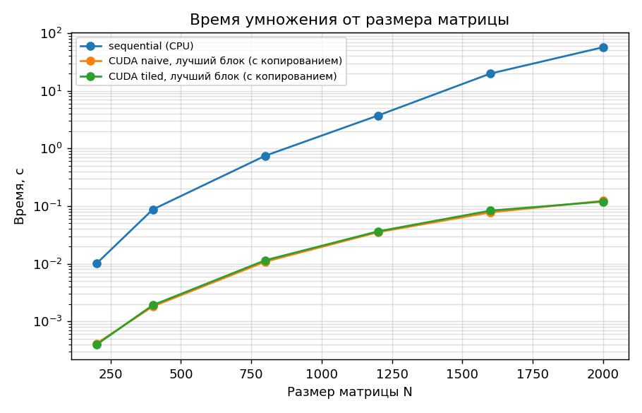
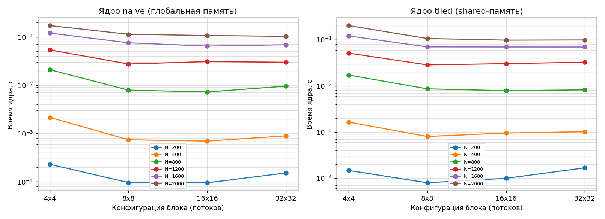
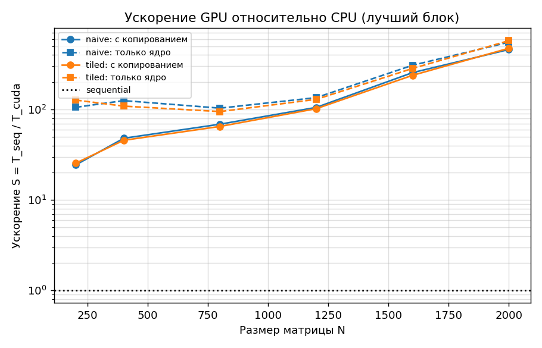
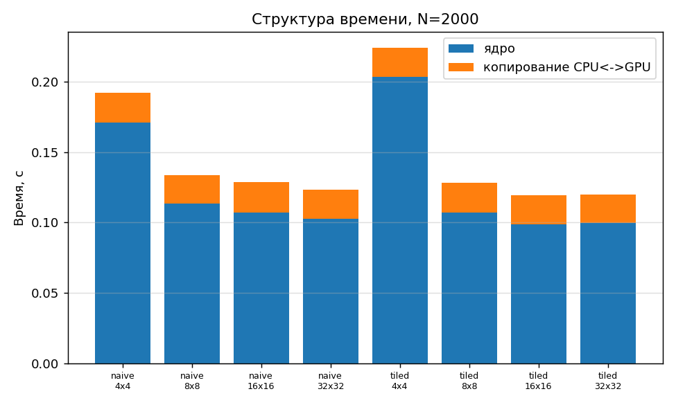

# Лабораторная работа №4

## Параллельное умножение квадратных матриц на CUDA

**Курс:** Параллельное программирование, 2026 **Дедлайн:** 02.12.2026

**Студент:** Храмов Кирилл  **Группа:** 6212-100503D

---

## Задание

Модифицировать программу из л/р №1 для параллельной работы по технологии CUDA.

- Провести эксперименты с разными размерами матриц.
- Провести эксперименты с различными конфигурациями сетки блоков.

## Среда выполнения

- **GPU:** Tesla T4 (compute capability 7.5), 40 мультипроцессоров
- **CUDA Toolkit:** Cuda compilation tools, release 13.0, V13.0.88
- **CPU (база для сравнения):** Intel(R) Xeon(R) CPU @ 2.00GHz (2 логических ядер)
- **ОС:** Ubuntu 24.04.4 LTS (Google Colab)
- **Компилятор:** g++ 11.4.0, nvcc 13.0, C++17
- **Сборка:** CMake + Make (Release, `-O3`)
- **Верификация/анализ:** Python 3, NumPy, Matplotlib

## Реализация

Код CUDA находится в `src/cuda_matmul.cu`, вызывается из `src/main.cpp` (стратегии `cuda_naive` и `cuda_tiled`).
Тип данных - `double`, один поток вычисляет один элемент результирующей матрицы.

1. **naive** - поток `(row, col)` считает сумму `A[row][k] * B[k][col]` по `k`, читая данные из глобальной памяти.
2. **tiled** - блок потоков по плиткам размера `BLOCK x BLOCK` загружает фрагменты `A` и `B` в разделяемую (shared) память
   (`__syncthreads()` между загрузкой и вычислением), что уменьшает число обращений к глобальной памяти.

**Конфигурация сетки.** Блок состоит из `B x B` потоков, сетка - из `ceil(N/B) x ceil(N/B)` блоков, поэтому каждый поток
получает свой элемент `C`, а для `N`, не кратных `B`, лишние потоки отсекаются проверкой границ. Исследуются
`B` = 4x4, 8x8, 16x16, 32x32; допустимо `B*B <= 1024` (предел числа потоков в блоке).

**Время.** Измеряется `cudaEvent`: `t общее` = копирование `A`, `B` на GPU + ядро + копирование `C` обратно;
`t ядра` = только ядро. Перед замером выполняется прогревочный запуск, инициализация контекста вынесена из замеров.
Чтение и запись файлов в время не входят. Ускорение `S = T_sequential / T_cuda`, где `T_sequential` - последовательная
версия на CPU для того же `N`. GFLOPS ядра = `2*N^3 / t ядра / 10^9`.

### Сборка и запуск

Нужны видеокарта NVIDIA, драйвер и CUDA Toolkit (`nvcc`).

```bash
mkdir build && cd build
cmake ..
make
cd ..

python3 tools/generate.py 500 data/input_500.txt     # генерация входных данных
./build/matmul data/input_500.txt 16 cuda tiled      # блок 16x16, ядро tiled
./build/matmul data/input_500.txt 16 cuda naive      # блок 16x16, ядро naive
python3 tools/verify.py data/input_500.txt data/output_500_cuda_tiled_b16.txt

./tools/run_experiments_lab4.sh                      # вся серия экспериментов, графики, этот отчёт
```

## Эксперименты

- Размеры N: 200, 400, 800, 1200, 1600, 2000
- Ядра: naive, tiled
- Конфигурации блока: 4x4, 8x8, 16x16, 32x32
- Запусков на конфигурацию: 3; в таблице среднее и стандартное отклонение σ.

## Результаты

Исходные данные для графиков (то же в `data/results_lab4.csv`, по запускам). `S общее` - ускорение с учётом копирования
данных, `S ядро` - по времени одного ядра.

| N | Режим | Блок | Сетка блоков | Запусков | t общее, с | t ядра, с | σ общ., с | S общее | S ядро | GFLOPS ядра | Верификация | Макс. отн. погрешность |
|---|---|---|---|---|---|---|---|---|---|---|---|---|
| 200 | sequential | - | - | 3 | 0.0101 | - | 0.0003 | 1.00 | - | 1.590 | OK | 1.1e-06 |
| 200 | CUDA naive | 4x4 | 50x50 | 3 | 0.0007 | 0.00023 | 0.0001 | 15.14 | 43.83 | 69.7 | OK | 1.1e-06 |
| 200 | CUDA naive | 8x8 | 25x25 | 3 | 0.0005 | 0.00010 | 0.0000 | 21.85 | 104.55 | 166.2 | OK | 1.1e-06 |
| 200 | CUDA naive | 16x16 | 13x13 | 3 | 0.0004 | 0.00010 | 0.0000 | 24.34 | 105.55 | 167.8 | OK | 1.1e-06 |
| 200 | CUDA naive | 32x32 | 7x7 | 3 | 0.0005 | 0.00015 | 0.0000 | 21.58 | 66.24 | 105.3 | OK | 1.1e-06 |
| 200 | CUDA tiled | 4x4 | 50x50 | 3 | 0.0005 | 0.00015 | 0.0000 | 21.06 | 68.67 | 109.2 | OK | 1.1e-06 |
| 200 | CUDA tiled | 8x8 | 25x25 | 3 | 0.0004 | 0.00008 | 0.0000 | 25.46 | 126.98 | 201.9 | OK | 1.1e-06 |
| 200 | CUDA tiled | 16x16 | 13x13 | 3 | 0.0004 | 0.00010 | 0.0000 | 23.53 | 101.71 | 161.7 | OK | 1.1e-06 |
| 200 | CUDA tiled | 32x32 | 7x7 | 3 | 0.0005 | 0.00017 | 0.0000 | 19.20 | 60.35 | 95.9 | OK | 1.1e-06 |
| 400 | sequential | - | - | 3 | 0.0873 | - | 0.0012 | 1.00 | - | 1.466 | OK | 6.0e-07 |
| 400 | CUDA naive | 4x4 | 100x100 | 3 | 0.0033 | 0.00215 | 0.0001 | 26.81 | 40.54 | 59.5 | OK | 6.0e-07 |
| 400 | CUDA naive | 8x8 | 50x50 | 3 | 0.0018 | 0.00074 | 0.0000 | 47.86 | 117.65 | 172.5 | OK | 6.0e-07 |
| 400 | CUDA naive | 16x16 | 25x25 | 3 | 0.0018 | 0.00070 | 0.0000 | 48.01 | 125.20 | 183.6 | OK | 6.0e-07 |
| 400 | CUDA naive | 32x32 | 13x13 | 3 | 0.0020 | 0.00089 | 0.0001 | 44.10 | 97.70 | 143.3 | OK | 6.0e-07 |
| 400 | CUDA tiled | 4x4 | 100x100 | 3 | 0.0027 | 0.00164 | 0.0000 | 31.77 | 53.11 | 77.9 | OK | 6.0e-07 |
| 400 | CUDA tiled | 8x8 | 50x50 | 3 | 0.0019 | 0.00080 | 0.0000 | 45.62 | 108.82 | 159.6 | OK | 6.0e-07 |
| 400 | CUDA tiled | 16x16 | 25x25 | 3 | 0.0020 | 0.00095 | 0.0001 | 43.17 | 91.55 | 134.2 | OK | 6.0e-07 |
| 400 | CUDA tiled | 32x32 | 13x13 | 3 | 0.0021 | 0.00102 | 0.0000 | 41.52 | 85.91 | 126.0 | OK | 6.0e-07 |
| 800 | sequential | - | - | 3 | 0.7466 | - | 0.0031 | 1.00 | - | 1.372 | OK | 2.8e-07 |
| 800 | CUDA naive | 4x4 | 200x200 | 3 | 0.0246 | 0.02094 | 0.0016 | 30.31 | 35.65 | 48.9 | OK | 2.8e-07 |
| 800 | CUDA naive | 8x8 | 100x100 | 3 | 0.0116 | 0.00788 | 0.0023 | 64.53 | 94.75 | 130.0 | OK | 2.8e-07 |
| 800 | CUDA naive | 16x16 | 50x50 | 3 | 0.0109 | 0.00722 | 0.0015 | 68.71 | 103.35 | 141.7 | OK | 2.8e-07 |
| 800 | CUDA naive | 32x32 | 25x25 | 3 | 0.0132 | 0.00955 | 0.0022 | 56.68 | 78.20 | 107.3 | OK | 2.8e-07 |
| 800 | CUDA tiled | 4x4 | 200x200 | 3 | 0.0208 | 0.01720 | 0.0039 | 35.86 | 43.42 | 59.5 | OK | 2.8e-07 |
| 800 | CUDA tiled | 8x8 | 100x100 | 3 | 0.0122 | 0.00863 | 0.0019 | 61.12 | 86.47 | 118.6 | OK | 2.8e-07 |
| 800 | CUDA tiled | 16x16 | 50x50 | 3 | 0.0115 | 0.00788 | 0.0019 | 64.93 | 94.77 | 130.0 | OK | 2.8e-07 |
| 800 | CUDA tiled | 32x32 | 25x25 | 3 | 0.0118 | 0.00821 | 0.0016 | 63.03 | 90.93 | 124.7 | OK | 2.8e-07 |
| 1200 | sequential | - | - | 3 | 3.7102 | - | 0.1259 | 1.00 | - | 0.931 | OK | 1.8e-07 |
| 1200 | CUDA naive | 4x4 | 300x300 | 3 | 0.0615 | 0.05388 | 0.0093 | 60.29 | 68.86 | 64.1 | OK | 1.8e-07 |
| 1200 | CUDA naive | 8x8 | 150x150 | 3 | 0.0352 | 0.02746 | 0.0047 | 105.32 | 135.11 | 125.9 | OK | 1.8e-07 |
| 1200 | CUDA naive | 16x16 | 75x75 | 3 | 0.0386 | 0.03085 | 0.0060 | 96.14 | 120.25 | 112.0 | OK | 1.8e-07 |
| 1200 | CUDA naive | 32x32 | 38x38 | 3 | 0.0382 | 0.02988 | 0.0010 | 97.08 | 124.16 | 115.7 | OK | 1.8e-07 |
| 1200 | CUDA tiled | 4x4 | 300x300 | 3 | 0.0594 | 0.05150 | 0.0098 | 62.44 | 72.05 | 67.1 | OK | 1.8e-07 |
| 1200 | CUDA tiled | 8x8 | 150x150 | 3 | 0.0364 | 0.02870 | 0.0071 | 101.95 | 129.27 | 120.4 | OK | 1.8e-07 |
| 1200 | CUDA tiled | 16x16 | 75x75 | 3 | 0.0383 | 0.03049 | 0.0056 | 96.89 | 121.70 | 113.4 | OK | 1.8e-07 |
| 1200 | CUDA tiled | 32x32 | 38x38 | 3 | 0.0405 | 0.03276 | 0.0070 | 91.50 | 113.25 | 105.5 | OK | 1.8e-07 |
| 1600 | sequential | - | - | 3 | 19.8469 | - | 0.5614 | 1.00 | - | 0.413 | OK | 1.4e-07 |
| 1600 | CUDA naive | 4x4 | 400x400 | 3 | 0.1331 | 0.11975 | 0.0110 | 149.07 | 165.73 | 68.4 | OK | 1.4e-07 |
| 1600 | CUDA naive | 8x8 | 200x200 | 3 | 0.0888 | 0.07546 | 0.0068 | 223.62 | 263.00 | 108.6 | OK | 1.4e-07 |
| 1600 | CUDA naive | 16x16 | 100x100 | 3 | 0.0778 | 0.06451 | 0.0023 | 255.01 | 307.64 | 127.0 | OK | 1.4e-07 |
| 1600 | CUDA naive | 32x32 | 50x50 | 3 | 0.0822 | 0.06874 | 0.0044 | 241.42 | 288.72 | 119.2 | OK | 1.4e-07 |
| 1600 | CUDA tiled | 4x4 | 400x400 | 3 | 0.1349 | 0.12149 | 0.0131 | 147.11 | 163.36 | 67.4 | OK | 1.4e-07 |
| 1600 | CUDA tiled | 8x8 | 200x200 | 3 | 0.0844 | 0.07040 | 0.0022 | 235.09 | 281.91 | 116.4 | OK | 1.4e-07 |
| 1600 | CUDA tiled | 16x16 | 100x100 | 3 | 0.0833 | 0.07005 | 0.0021 | 238.16 | 283.34 | 117.0 | OK | 1.4e-07 |
| 1600 | CUDA tiled | 32x32 | 50x50 | 3 | 0.0836 | 0.06998 | 0.0020 | 237.41 | 283.61 | 117.1 | OK | 1.4e-07 |
| 2000 | sequential | - | - | 3 | 56.6735 | - | 0.4471 | 1.00 | - | 0.282 | OK | 1.1e-07 |
| 2000 | CUDA naive | 4x4 | 500x500 | 3 | 0.1920 | 0.17111 | 0.0016 | 295.13 | 331.22 | 93.5 | OK | 1.1e-07 |
| 2000 | CUDA naive | 8x8 | 250x250 | 3 | 0.1338 | 0.11330 | 0.0133 | 423.42 | 500.21 | 141.2 | OK | 1.1e-07 |
| 2000 | CUDA naive | 16x16 | 125x125 | 3 | 0.1285 | 0.10688 | 0.0175 | 440.95 | 530.25 | 149.7 | OK | 1.1e-07 |
| 2000 | CUDA naive | 32x32 | 63x63 | 3 | 0.1234 | 0.10255 | 0.0026 | 459.19 | 552.67 | 156.0 | OK | 1.1e-07 |
| 2000 | CUDA tiled | 4x4 | 500x500 | 3 | 0.2243 | 0.20348 | 0.0007 | 252.68 | 278.52 | 78.6 | OK | 1.1e-07 |
| 2000 | CUDA tiled | 8x8 | 250x250 | 3 | 0.1281 | 0.10689 | 0.0075 | 442.58 | 530.21 | 149.7 | OK | 1.1e-07 |
| 2000 | CUDA tiled | 16x16 | 125x125 | 3 | 0.1196 | 0.09857 | 0.0123 | 473.91 | 574.97 | 162.3 | OK | 1.1e-07 |
| 2000 | CUDA tiled | 32x32 | 63x63 | 3 | 0.1201 | 0.09949 | 0.0169 | 471.97 | 569.64 | 160.8 | OK | 1.1e-07 |









## Верификация

Результат первого запуска каждой конфигурации сравнивался с `A @ B` из NumPy. Допуск - `1e-5` относительно `|A|@|B|`
(программа выводит числа с 6 значащими цифрами, порядок суммирования различается).

## Выводы

1. **Корректность.** Результаты CUDA-версии (оба ядра, все конфигурации блоков) совпали с эталоном NumPy (`A @ B`), максимальная относительная погрешность 1.1e-06.
2. **Лучшие конфигурации.** Для N=2000: naive: блок 32x32 (сетка 63x63 = 3969 блоков), время ядра 0.1025 с, 156.0 GFLOPS; tiled: блок 16x16 (сетка 125x125 = 15625 блоков), время ядра 0.0986 с, 162.3 GFLOPS.
3. **naive и tiled.** При N=2000 лучшее tiled-ядро быстрее лучшего naive в 1.04 раза: плитки в shared-памяти сокращают число обращений к глобальной памяти примерно в размер плитки раз, и это самый заметный фактор оптимизации, если ядро упирается в память.
4. **Размер блока.** Время ядра при N=2000 зависит от конфигурации сетки: naive: от 0.1025 с (блок 32x32) до 0.1711 с (блок 4x4), разброс в 1.7 раза; tiled: от 0.0986 с (блок 16x16) до 0.2035 с (блок 4x4), разброс в 2.1 раза. Блок 4x4 содержит 16 потоков, меньше размера варпа (32), поэтому часть исполнительных устройств простаивает; очень большие блоки (32x32 = 1024 потока) ограничивают число одновременно резидентных блоков на мультипроцессоре, оптимальная конфигурация зависит от видеокарты и определяется по таблице выше.
5. **Сравнение с CPU.** При N=2000 лучшая CUDA-конфигурация (tiled, 16x16) даёт ускорение S = 473.9 с учётом копирования данных и 575.0 по времени одного ядра относительно последовательной версии на CPU (56.67 с).
6. **Копирование данных.** На копирование CPU<->GPU при N=2000 приходится 18% общего времени (0.0210 с из 0.1196 с). Для малых матриц (N=200) ускорение с копированием заметно ниже (25.5 против 473.9): накладные расходы на копирование и запуск ядра занимают большую долю времени. Объём данных растёт как N^2, а вычислений - как N^3, поэтому с ростом N доля копирования, как правило, падает.
7. **Точность.** Вычисления выполнены в `double` (как в остальных лабах, для сопоставимости и проверки по NumPy). У большинства игровых и облачных видеокарт производительность в double в десятки раз ниже, чем в float, поэтому абсолютные значения GFLOPS ниже пиковых для float.
