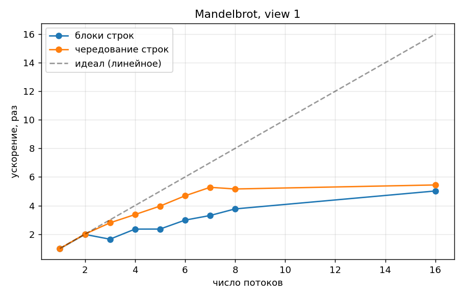
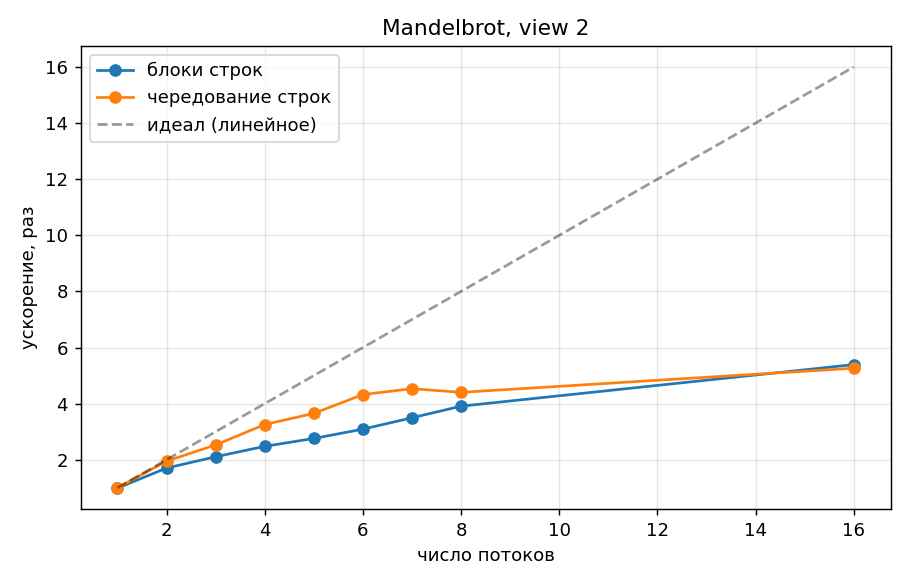
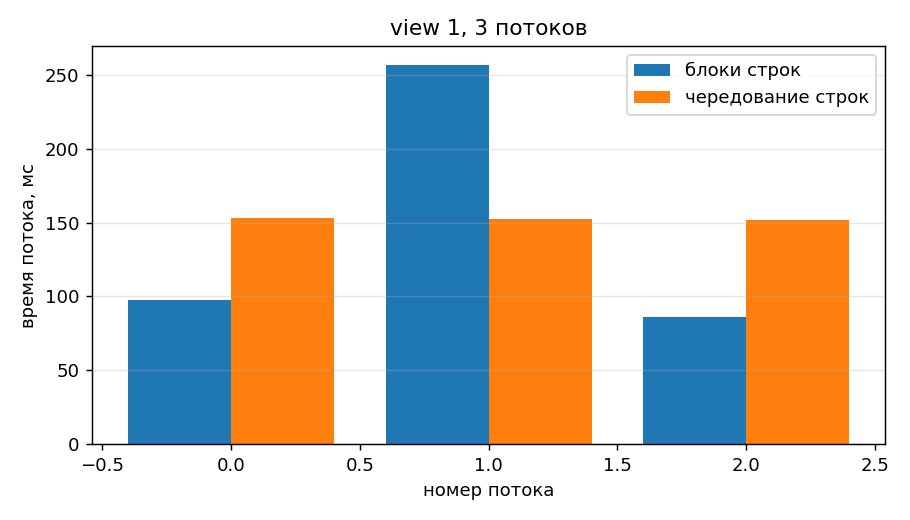
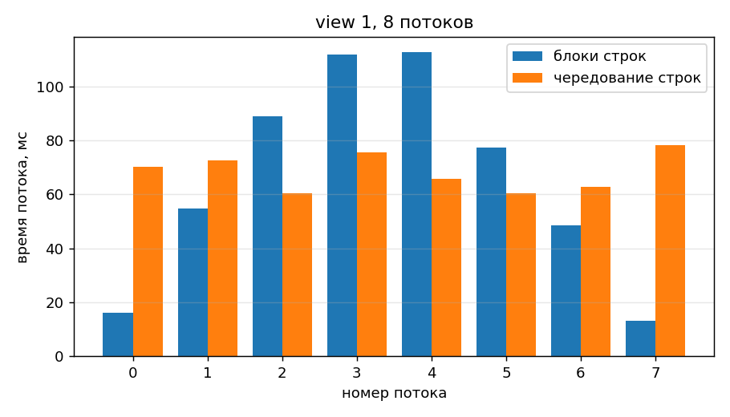
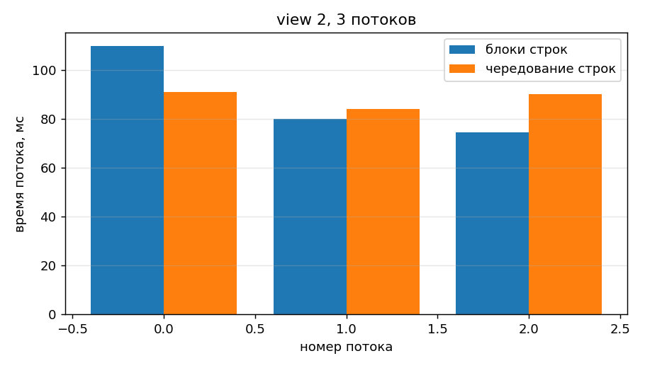
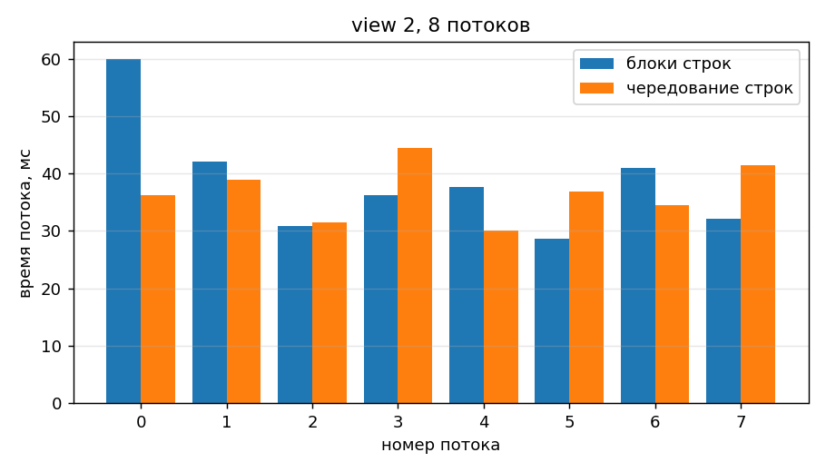

# Лабораторная работа №5

## Параллельное построение множества Мандельброта (`std::thread`)

**Курс:** Параллельное программирование, 2026 **Дедлайн:** 15.12.2026

**Студент:** Храмов Кирилл  **Группа:** 6212-100503D

---

## Задание

Из репозитория https://github.com/stanford-cs149/asst1 выполнить одну из программ по пунктам задания. Выбрана **Program 1: Parallel Fractal Generation Using Threads** (код в `asst1/prog1_mandelbrot_threads`):

1. Распараллелить построение изображения на 2 потока: верхнюю половину считает один поток, нижнюю — другой.
2. Обобщить на 2–8 потоков (пространственная декомпозиция), построить график ускорения для view 1 и view 2, объяснить, линейно ли ускорение.
3. Замерить время работы каждого потока и объяснить по нему график ускорения.
4. Придумать статическое разбиение без синхронизации, дающее ускорение ≈7–8× на 8 потоках для обоих view.
5. Запустить на 16 потоках и объяснить, есть ли выигрыш по сравнению с 8.

## Решение

Изменения в заготовке — функция `workerThreadStart` в `mandelbrotThread.cpp` (режим разбиения задаётся ключом `-m block|interleaved`) и ключи `-m`, `-T`, `-c` в `main.cpp`:

```cpp
void workerThreadStart(WorkerArgs * const args) {
    double startTime = CycleTimer::currentSeconds();
    if (g_decomposition == 0) {            // блоки: поток i - строки [i*H/T, (i+1)*H/T)
        int startRow = args->threadId * args->height / args->numThreads;
        int endRow = (args->threadId + 1) * args->height / args->numThreads;
        mandelbrotSerial(..., startRow, endRow - startRow, ...);
    } else {                               // чередование: поток i - строки i, i+T, i+2T, ...
        for (int row = args->threadId; row < (int)args->height; row += args->numThreads)
            mandelbrotSerial(..., row, 1, ...);
    }
    g_threadSeconds[args->threadId] = CycleTimer::currentSeconds() - startTime;  // своя ячейка - без синхронизации
}
```

```bash
cd asst1/prog1_mandelbrot_threads && make
./mandelbrot -t 8 -v 1 -m interleaved -T     # 8 потоков, view 1, время каждого потока
cd ../.. && bash tools/run_experiments_lab5.sh && python3 tools/plot_lab5.py   # вся серия и этот отчёт
```

## Условие и среда

Изображение 1600×1200, 256 итераций, два набора параметров (view 1 и view 2). Последовательная версия — `mandelbrotSerial`; параллельная — `std::thread` (число потоков−1 новых потоков, главный поток тоже работает). Результат каждой параллельной версии проверяется сравнением с последовательным изображением (программа сообщает об ошибке при расхождении). Время — минимум из 5 запусков внутри программы, затем медиана из нескольких запусков программы.

- Процессор: 12th Gen Intel(R) Core(TM) i3-1215U (логических ядер: 8)
- ОС: Linux 6.18.54.1-microsoft-standard-WSL2
- Компилятор: c++ (Ubuntu 15.2.0-16ubuntu1) 15.2.0, `-O3 -std=c++11`

## Пункт 1. Два потока: верхняя и нижняя половины

Поток 0 считает строки `[0, H/2)`, поток 1 — `[H/2, H)` (блочное разбиение при `T=2`, режим `-m block`).

- view 1: ускорение 1,98× (идеал — 2×).
- view 2: ускорение 1,70× (идеал — 2×).

## Пункт 2. 2…8 потоков, блочное разбиение

Поток `i` получает непрерывный блок строк `[i·H/T, (i+1)·H/T)`.





- view 1: при 8 потоках ускорение 3,77× (эффективность 0,47), линейным рост не является.
- view 2: при 8 потоках ускорение 3,91× (эффективность 0,49), линейным рост не является.

**Почему ускорение нелинейное.** Стоимость строки зависит от числа итераций: точки внутри множества Мандельброта требуют все 256 итераций, точки снаружи выходят быстро. Центральные строки изображения (view 1) «тяжелее» крайних, поэтому при блочном разбиении потоки, получившие середину картинки, работают заметно дольше остальных, а общее время определяется самым медленным потоком. Особенно это видно при 3 потоках: средний поток получает почти всё множество, и ускорение близко к ускорению для 2 потоков, а не к 3×.

## Пункт 3. Время работы каждого потока

В `workerThreadStart` замеряется время работы потока (`CycleTimer::currentSeconds()` до и после расчёта), результат пишется в отдельную ячейку массива `g_threadSeconds[threadId]`, поэтому синхронизация не нужна. Показан самый быстрый из прогонов.









- view 1, 3 потоков, блоки: время потоков 97,8, 256,8, 86,2 мс; max/min = 2,98.
- view 1, 8 потоков, блоки: время потоков 16,0, 54,7, 88,9, 111,7, 112,8, 77,2, 48,5, 13,0 мс; max/min = 8,66.
- view 2, 3 потоков, блоки: время потоков 109,8, 79,9, 74,5 мс; max/min = 1,47.
- view 2, 8 потоков, блоки: время потоков 60,0, 42,1, 30,9, 36,2, 37,6, 28,7, 41,0, 32,1 мс; max/min = 2,09.

График ускорения объясняется дисбалансом: чем больше отношение max/min, тем сильнее ускорение отстаёт от числа потоков. Дополнительно ускорение ограничено числом физических ядер процессора и накладными расходами на создание потоков.

## Пункт 4. Улучшенное статическое разбиение

**Идея.** Строки распределяются циклически: поток `i` считает строки `i, i+T, i+2T, …` (режим `interleaved`, цикл `for (row = threadId; row < height; row += numThreads)`). Тяжёлые и лёгкие строки равномерно перемешиваются между потоками, нагрузка выравнивается без динамической балансировки и без синхронизации (потоки пишут в непересекающиеся строки выходного массива). Правило одно и то же для любого числа потоков.

- view 1, 8 потоков: **5,16×** (блоки: 3,77×); max/min времени потоков = 1,30.
- view 2, 8 потоков: **4,40×** (блоки: 3,91×); max/min времени потоков = 1,48.

Ускорение 7–8× из задания рассчитано на 8 одинаковых ядер (машины курса CS149). Здесь получено 5,16×, и это предел самой машины, а не разбиения: Intel Core i3-1215U — гибридный процессор с 2 производительными ядрами (P-cores, с Hyper-Threading — 4 логических потока) и 4 энергоэффективными ядрами (E-cores), то есть 6 физических ядер и 8 логических. Два потока на одном P-ядре делят его вычислительные блоки, а E-ядра медленнее P-ядер, поэтому даже при равной нагрузке по строкам потоки работают с разной скоростью. Отношение max/min времени потоков при чередовании (≈1,3–1,5) — это разница в скорости ядер, а не в объёме работы.

## Пункт 5. 16 потоков

- view 1: 8 потоков — 5,16×, 16 потоков — 5,44× (отношение 1,05).
- view 2: 8 потоков — 4,40×, 16 потоков — 5,26× (отношение 1,20).

Логических ядер на машине 8, поэтому 16 потоков не могут исполняться одновременно: ОС переключает их, и прироста «от новых ядер» нет. 
Небольшой выигрыш всё же есть: при 16 потоках каждый поток получает вдвое меньше строк, и когда поток на быстром ядре заканчивает свою часть, планировщик ОС отдаёт освободившееся ядро следующему потоку. Это частично выравнивает разницу в скорости P- и E-ядер — статическое разбиение начинает работать как грубая динамическая балансировка. Предел по-прежнему задаёт число ядер.

## Таблица исходных данных

| view | разбиение | потоков | T_посл, мс | T_парал, мс | ускорение | эффективность |
|---|---|---|---|---|---|---|
| 1 | блоки строк | 1 | 353,6 | 359,5 | 0,98 | 0,98 |
| 1 | блоки строк | 2 | 427,7 | 215,8 | 1,98 | 0,99 |
| 1 | блоки строк | 3 | 427,5 | 259,3 | 1,65 | 0,55 |
| 1 | блоки строк | 4 | 423,4 | 179,9 | 2,35 | 0,59 |
| 1 | блоки строк | 5 | 428,9 | 182,0 | 2,36 | 0,47 |
| 1 | блоки строк | 6 | 427,8 | 143,4 | 2,98 | 0,50 |
| 1 | блоки строк | 7 | 433,1 | 131,0 | 3,30 | 0,47 |
| 1 | блоки строк | 8 | 427,1 | 113,4 | 3,77 | 0,47 |
| 1 | блоки строк | 16 | 432,3 | 86,1 | 5,02 | 0,31 |
| 1 | чередование строк | 1 | 427,2 | 429,8 | 0,99 | 0,99 |
| 1 | чередование строк | 2 | 428,1 | 213,7 | 2,00 | 1,00 |
| 1 | чередование строк | 3 | 427,3 | 153,0 | 2,79 | 0,93 |
| 1 | чередование строк | 4 | 424,6 | 125,9 | 3,37 | 0,84 |
| 1 | чередование строк | 5 | 428,8 | 108,2 | 3,96 | 0,79 |
| 1 | чередование строк | 6 | 424,7 | 90,7 | 4,68 | 0,78 |
| 1 | чередование строк | 7 | 424,4 | 80,4 | 5,28 | 0,75 |
| 1 | чередование строк | 8 | 430,9 | 83,5 | 5,16 | 0,65 |
| 1 | чередование строк | 16 | 427,2 | 78,5 | 5,44 | 0,34 |
| 2 | блоки строк | 1 | 238,1 | 241,3 | 0,99 | 0,99 |
| 2 | блоки строк | 2 | 240,3 | 141,0 | 1,70 | 0,85 |
| 2 | блоки строк | 3 | 238,0 | 113,0 | 2,11 | 0,70 |
| 2 | блоки строк | 4 | 242,4 | 97,8 | 2,48 | 0,62 |
| 2 | блоки строк | 5 | 238,6 | 86,5 | 2,76 | 0,55 |
| 2 | блоки строк | 6 | 239,4 | 77,4 | 3,09 | 0,52 |
| 2 | блоки строк | 7 | 234,3 | 67,0 | 3,50 | 0,50 |
| 2 | блоки строк | 8 | 247,5 | 63,3 | 3,91 | 0,49 |
| 2 | блоки строк | 16 | 238,0 | 44,1 | 5,39 | 0,34 |
| 2 | чередование строк | 1 | 238,6 | 238,2 | 1,00 | 1,00 |
| 2 | чередование строк | 2 | 239,6 | 122,9 | 1,95 | 0,97 |
| 2 | чередование строк | 3 | 239,9 | 94,9 | 2,53 | 0,84 |
| 2 | чередование строк | 4 | 238,0 | 73,1 | 3,26 | 0,81 |
| 2 | чередование строк | 5 | 237,1 | 64,9 | 3,65 | 0,73 |
| 2 | чередование строк | 6 | 239,0 | 55,3 | 4,32 | 0,72 |
| 2 | чередование строк | 7 | 208,4 | 46,0 | 4,53 | 0,65 |
| 2 | чередование строк | 8 | 229,1 | 52,0 | 4,40 | 0,55 |
| 2 | чередование строк | 16 | 243,6 | 46,3 | 5,26 | 0,33 |

## Выводы

- view 1: лучшее ускорение до 8 потоков — 5,28× (чередование строк, 7 потоков).
- view 2: лучшее ускорение до 8 потоков — 4,53× (чередование строк, 7 потоков).
- Блочное разбиение даёт плохую балансировку: стоимость строк неравномерна, ускорение ограничено самым нагруженным потоком.
- Циклическое (чередующееся) статическое разбиение выравнивает нагрузку без синхронизации и даёт ускорение, близкое к числу ядер.
- Потоков больше, чем аппаратных ядер, ускорения не добавляют.
